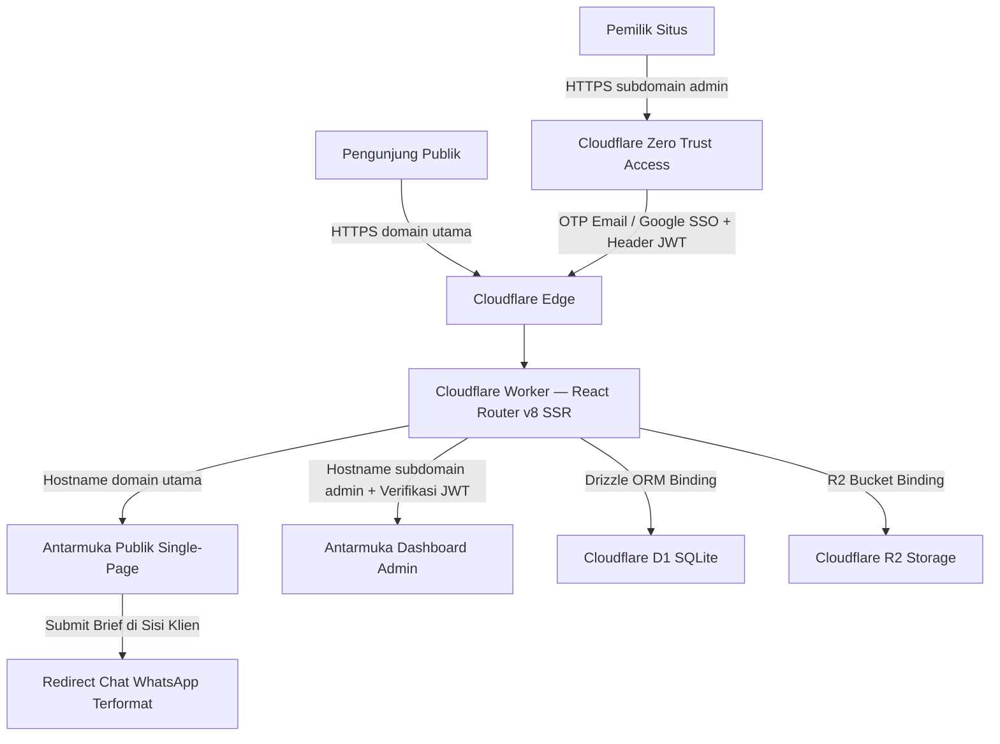

# Product Requirements Document — tegardev

## 1. Ringkasan Produk & Tujuan Strategis

### 1.1 Gambaran Umum
`tegardev` adalah website portofolio personal sekaligus katalog paket pembuatan website dan aplikasi web milik Tegar sebagai Full-Stack Developer. Sistem ini terdiri dari dua antarmuka yang berjalan di dalam satu aplikasi terpadu:
1. **Halaman Publik Single-Page** pada domain utama untuk menampilkan profil keahlian, proyek unggulan, alur kerja, katalog paket beserta harga, testimoni klien, serta tanya jawab.
2. **Dashboard Admin** pada subdomain khusus yang diproteksi di tepi jaringan untuk mengelola seluruh konten dinamis situs secara mandiri.

### 1.2 Tujuan Utama
- **Akuisisi Klien Proyek:** Memudahkan calon klien dari sektor pendidikan, instansi, dan bisnis memahami cakupan layanan, melihat transparansi estimasi harga paket seperti Sistem PPDB Online, serta mengirim brief kebutuhan langsung ke WhatsApp.
- **Personal Brand Full-Stack Developer:** Menampilkan kualitas rekayasa perangkat lunak end-to-end melalui proyek nyata maupun arsitektur website `tegardev` sendiri sehingga tetap kredibel di hadapan rekruter dan pemimpin teknis.
- **Kemudahan Pengelolaan Konten:** Memungkinkan pembaruan harga paket, rincian fitur, add-on, daftar proyek, gambar mockup, testimoni, dan tanya jawab kapan saja melalui Dashboard Admin tanpa perlu mengubah kode sumber.

### 1.3 Target Pengguna
| Segmen Pengguna | Kebutuhan Utama | Tujuan Konversi |
|---|---|---|
| Kepala Sekolah, Panitia PPDB, & Pengelola Instansi | Kepastian modul yang didapat, kisaran biaya awal serta biaya tahunan, contoh hasil kerja, dan cara diskusi yang praktis | Mengisi modal `Brief Proyek` pada paket pendidikan lalu lanjut diskusi di WhatsApp |
| Pemilik Bisnis & UMKM | Kecepatan pengerjaan, tampilan profesional, dan kejelasan paket Landing Page, Company Profile, atau Toko Online | Memilih paket bisnis yang sesuai dan mengirim brief via WhatsApp |
| Klien Kebutuhan Sistem Khusus | Bukti kemampuan teknis membangun sistem full-stack, integrasi API, dan arsitektur database | Mengajukan diskusi kebutuhan pada kategori `Sistem Custom` |
| Rekruter & Manajer Rekayasa | Melihat keahlian teknologi, kualitas antarmuka, demo langsung, dan repositori kode proyek unggulan | Meninjau portofolio proyek serta menghubungi melalui kontak resmi atau unduhan CV |

---

## 2. Arsitektur Sistem & Tech Stack

### 2.1 Diagram Arsitektur



### 2.2 Spesifikasi Teknologi
- **Framework Aplikasi:** React Router v8 (`8.5+` dalam Framework Mode SSR) dijalankan menggunakan `@cloudflare/vite-plugin` serta `RouterContextProvider` pada handler Worker.
- **Runtime & Hosting:** Cloudflare Workers dengan satu kode dasar untuk menangani domain utama dan subdomain admin.
- **Database:** Cloudflare D1 berbasis SQLite dengan Drizzle ORM (`drizzle-orm/d1`) dan manajemen migrasi skema melalui `drizzle-kit` (`driver: "d1-http"`).
- **Penyimpanan Media:** Cloudflare R2 untuk menyimpan gambar tangkapan layar proyek, dokumen CV, dan aset pendukung dengan header cache jangka panjang.
- **Keamanan Subdomain Admin:** Cloudflare Zero Trust Access berbasis OTP email atau Google SSO di depan `admin.<domain>`, diperkuat validasi token header `Cf-Access-Jwt-Assertion` di dalam middleware Worker menggunakan kunci publik JWKS Cloudflare Access dan `POLICY_AUD`.
- **Styling & Komponen UI:** Tailwind CSS v4, komponen interaktif dari `shadcn/ui`, dan pustaka ikon `lucide-react`.
- **Bahasa Antarmuka:** Bahasa Indonesia penuh di seluruh halaman publik maupun Dashboard Admin.

### 2.3 Routing Berbasis Hostname pada Satu Worker
Aplikasi mendeteksi header `Host` atau `URL.hostname` di dalam `RouterContextProvider` pada pintu masuk Cloudflare Worker:
1. **Domain Utama (`<domain>` dan `www.<domain>`):** Hanya melayani rute publik single-page, sitemap, robots, serta endpoint pembacaan aset media publik R2. Percobaan mengakses path admin dari domain utama akan dikembalikan dengan status `404`.
2. **Subdomain Admin (`admin.<domain>`):** Hanya melayani antarmuka Dashboard Admin dan action mutasi CRUD. Setiap request wajib melewati pemeriksaan ganda: kebijakan Cloudflare Zero Trust Access di tepi jaringan dan verifikasi kriptografis tanda tangan JWT `Cf-Access-Jwt-Assertion` di sisi server Worker.
3. **Proteksi Subdomain Bawaan `.workers.dev`:** Menonaktifkan akses publik `workers.dev` di konfigurasi produksi `wrangler.jsonc` (`workers_dev: false`) agar aplikasi tidak dapat diakses melewati jalur di luar Cloudflare Access.

### 2.4 Struktur Direktori Modular
Seluruh komponen wajib dipisahkan ke file tersendiri sesuai tanggung jawabnya agar mudah dirawat dan digunakan kembali lintas halaman:

```text
tegardev/
├── app/
│   ├── components/
│   │   ├── ui/                  # Komponen dasar shadcn/ui yang dikustomisasi sesuai DESIGN.md
│   │   ├── public/              # Komponen seksi halaman publik per file terpisah
│   │   │   ├── announcement-bar.tsx
│   │   │   ├── public-navbar.tsx
│   │   │   ├── hero-section.tsx
│   │   │   ├── brand-wordmark.tsx
│   │   │   ├── about-skills-section.tsx
│   │   │   ├── featured-projects-section.tsx
│   │   │   ├── project-split-row.tsx
│   │   │   ├── pricing-section.tsx
│   │   │   ├── package-card.tsx
│   │   │   ├── brief-modal.tsx
│   │   │   ├── workflow-section.tsx
│   │   │   ├── testimonials-section.tsx
│   │   │   ├── faq-section.tsx
│   │   │   ├── cta-band-section.tsx
│   │   │   └── public-footer.tsx
│   │   └── admin/               # Komponen reusable Dashboard Admin
│   │       ├── admin-shell.tsx
│   │       ├── admin-sidebar.tsx
│   │       ├── image-uploader.tsx
│   │       ├── confirm-delete-dialog.tsx
│   │       └── sortable-order-controls.tsx
│   ├── db/
│   │   ├── schema.ts            # Definisi tabel Drizzle ORM
│   │   ├── index.ts             # Inisialisasi koneksi Drizzle D1
│   │   └── seed.ts              # Data awal portofolio & paket layanan
│   ├── lib/
│   │   ├── access-jwt.server.ts # Verifikasi Cf-Access-Jwt-Assertion
│   │   ├── host-routing.ts      # Deteksi domain publik vs subdomain admin
│   │   ├── r2.server.ts         # Utilitas unggah, baca, & hapus objek R2
│   │   ├── whatsapp.ts          # Penyusun pesan brief WhatsApp terformat
│   │   └── validations.ts       # Skema validasi input form
│   ├── routes/
│   │   ├── _public._index.tsx   # Halaman utama Single-Page publik
│   │   ├── media.$key.tsx       # Pengiriman aset publik R2 dengan header cache
│   │   ├── admin._layout.tsx    # Layout utama Dashboard Admin + guard JWT
│   │   ├── admin._index.tsx     # Ringkasan konten
│   │   ├── admin.profil.tsx     # CRUD Profil, Pengaturan Situs, & Keahlian
│   │   ├── admin.proyek.tsx     # CRUD Proyek Unggulan
│   │   ├── admin.paket.tsx      # CRUD Kategori, Paket Harga, Fitur, & Add-on
│   │   ├── admin.testimoni.tsx  # CRUD Testimoni Klien
│   │   ├── admin.tanya-jawab.tsx# CRUD Tanya Jawab
│   │   └── admin.media.tsx      # Manajemen Berkas R2
│   ├── app.css                  # Token warna DESIGN.md & aturan tipografi
│   └── root.tsx
├── drizzle/                     # Berkas migrasi SQL tergenerasi
├── workers/
│   └── app.ts                   # Entrypoint Worker + RouterContextProvider
├── DESIGN.md
├── PRD.md
├── drizzle.config.ts
├── wrangler.jsonc
└── package.json
```

---

## 3. Sistem Desain & Standar Antarmuka

Seluruh halaman publik, Modal `Brief Proyek`, maupun Dashboard Admin wajib menerapkan identitas visual gelap hangat dan aksen rust dari [DESIGN.md](file:///d:/Proyek/Personal/tegardev/DESIGN.md) secara seragam, dengan penyelarasan ketat terhadap aturan desain berikut:

### 3.1 Token Warna & Tipografi Seragam
- **Palet Warna Solid:**
  - `--bg`: `#121010` untuk latar utama halaman serta bidang input aktif yang kontras terhadap panel sekunder.
  - `--bg2`: `#1A1512` untuk panel kartu, modal, dan seksi alternatif.
  - `--rust`: `#A8391C` sebagai satu-satunya warna aksen utama untuk tombol primary, sorotan kata `dev` pada wordmark, tab aktif, dan band CTA.
  - `--rust-dark`: `#7E2912` untuk topbar tipis dan state hover tombol utama.
  - `--cream`: `#F3EEE6` untuk teks utama dan nilai input aktif.
  - `--cream-dim`: `#C9C0B3` untuk teks deskripsi sekunder.
  - `--line`: `#2E2622` untuk garis pembatas tipis `1px` dan border komponen.
- **Tipografi:**
  - **Anton** untuk wordmark raksasa `TEGARDEV` di Hero serta Footer dan judul display seksi.
  - **Work Sans** (`400–700`) untuk seluruh teks tubuh, navigasi, tabel, label, dan kontrol form.
- **Geometri:** Sudut komponen tajam dan konsisten di rentang `3px–6px`, lebar kontainer maksimum `1160px` dengan padding horizontal `28px`, serta jarak vertikal antar seksi `64px–80px`.

### 3.2 Aturan Ketat Antarmuka & Microcopy
1. **Tanpa Gradasi & Tanpa Bayangan:** Dilarang menggunakan gradasi warna pada latar, teks, maupun garis batas, serta dilarang memakai drop shadow pada kartu. Pemisahan ruang murni dibentuk dari kontras blok warna solid `#121010`, `#1A1512`, `#A8391C`, dan garis `1px` `#2E2622`.
2. **Larangan Pill Badge di Atas Judul:** Dilarang menempatkan pill badge atau label dekoratif kecil di atas judul seksi maupun heading mana pun, termasuk pada seksi Band CTA penuh. Tag ber-border tipis hanya digunakan pada daftar teknologi di dalam panel proyek atau strip informasi di bawah Hero.
3. **Larangan Emoji & Kewajiban Unboxed Icons:** Dilarang menggunakan karakter emoji di seluruh antarmuka, placeholder, pesan template WhatsApp, maupun konten teks. Seluruh ikon wajib menggunakan `lucide-react` dan disajikan langsung sejajar teks tanpa kotak pembungkus ber-border atau lingkaran latar artifisial.
4. **Pembatasan Ikon pada Tombol:** Tombol aksi standar pada form maupun modal seperti `Simpan`, `Batal`, `Kirim ke WhatsApp`, dan `Pilih Paket` wajib berupa teks murni tanpa ikon. Ikon pada tombol hanya diizinkan pada navigasi utama sidebar Dashboard Admin dan tombol aksi kompak di baris tabel admin.
5. **Kewajiban Komponen Library:** Dilarang menggunakan elemen interaktif bawaan browser yang mentah seperti `<select>` native; seluruh dropdown, tab, modal dialog, dan accordion wajib menggunakan komponen `shadcn/ui` yang telah disesuaikan token warnanya dengan `DESIGN.md`.
6. **Affordance Input Form pada Tema Gelap:** Kotak input dan textarea aktif pada Modal `Brief Proyek` maupun Dashboard Admin menggunakan latar `#121010` yang tegas di atas permukaan panel `#1A1512`, dilengkapi border `1px solid #2E2622` yang berubah menjadi `#A8391C` saat fokus dan teks `#F3EEE6` agar jelas terlihat aktif serta tidak menyerupai komponen nonaktif. Tombol filter/tab yang tidak aktif menggunakan varian `outline` atau `ghost`.
7. **Microcopy Lugas:** Seluruh label tombol, judul menu, dan modal menggunakan 1–3 kata fungsional Bahasa Indonesia yang alami tanpa kata pengisi bertele-tele dan tanpa sisipan terjemahan di dalam kurung.

---

## 4. Spesifikasi Fungsional Halaman Publik Single-Page

Seluruh konten publik disajikan secara utuh di satu halaman pada domain utama dengan navigasi anchor yang mulus dari atas ke bawah:

### 4.1 Topbar Pengumuman
- Satu baris ringkas di paling atas halaman berlatar `--rust-dark` (`#7E2912`) dan teks `--cream`.
- Menampilkan status ketersediaan pengerjaan proyek (contoh: `Tersedia untuk pengerjaan proyek website & sistem bulan ini`) yang dapat diaktifkan, diubah teksnya, atau disembunyikan melalui Dashboard Admin.

### 4.2 Navbar Sticky
- Menempel di atas layar saat halaman digulir, berlatar `#121010` dengan garis bawah `1px` `--line`.
- Sisi kiri memuat identitas teks `tegardev`.
- Sisi kanan memuat tautan navigasi ke seksi halaman: `Tentang`, `Proyek`, `Daftar Harga`, `Alur Kerja`, `Testimoni`, dan `Tanya Jawab`, ditutup satu tombol primary `Mulai Proyek` yang menggulir ke seksi `Daftar Harga`.
- Pada layar mobile, tautan navigasi diringkas ke dalam komponen `Sheet` samping dari `shadcn/ui`.

### 4.3 Hero & Wordmark Utama
- **Baris Atas 2 Kolom:** Judul nilai tawar utama di kolom kiri berdampingan dengan paragraf pengantar singkat 1–2 kalimat sebagai Full-Stack Developer serta dua tombol aksi (`Lihat Paket` berlatar `--rust` dan `Lihat Proyek` bervarian `outline`). Opsional tautan teks `Unduh CV` jika berkas CV diaktifkan di pengaturan admin.
- **Wordmark Raksasa:** Elemen visual bintang selebar kontainer bertuliskan `TEGARDEV` menggunakan font **Anton** (`70px–190px` responsif), di mana suku kata `DEV` diberi warna aksen `--rust`.
- **Strip Keahlian Horizontal:** Baris tipis dibatasi garis `1px` `--line` di atas dan bawah yang menampilkan cakupan kapabilitas inti (contoh: `Pengembangan Full-Stack`, `Arsitektur Database`, `Sistem Pendidikan & PPDB`, `Aplikasi Web Bisnis`, `Integrasi API & Pembayaran`), dapat digeser horizontal pada layar sempit.

### 4.4 Tentang Saya & Keahlian Teknologi
- Judul seksi `Tentang Saya` diikuti ringkasan padat mengenai pendekatan kerja rekayasa perangkat lunak dari perancangan antarmuka hingga deployment server.
- Grid kartu `3–5` kolom pada desktop (menyusut ke `2` lalu `1` kolom di mobile) berlatar `--bg2` dan border `--line` untuk mengelompokkan keahlian teknologi utama (Frontend, Backend, Database, Cloud & DevOps) beserta ikon `lucide-react` unboxed sejajar nama grup/teknologi.

### 4.5 Proyek Unggulan
- Judul seksi `Proyek Unggulan` tanpa filter kategori dan tanpa modal tambahan.
- Daftar proyek pilihan ditampilkan memanjang ke bawah secara berurutan mengikuti pola **Feature Split 2 Kolom**:
  - **Panel Visual:** Menampilkan tangkapan layar aplikasi resolusi tajam dari Cloudflare R2 di atas bidang gelap ber-border `--line`.
  - **Panel Informasi:** Menampilkan nama proyek, ringkasan konteks masalah dan solusi arsitektur full-stack dalam 2–3 kalimat padat, deretan tag teknologi yang digunakan, serta tombol `Lihat Demo` dan `Kode Sumber` (masing-masing hanya muncul apabila URL tersedia).

### 4.6 Daftar Harga & Katalog Paket Layanan
- Judul seksi `Daftar Harga` disertai subjudul singkat mengenai transparansi cakupan layanan.
- Komponen `Tabs` dari `shadcn/ui` untuk memilih satu dari **3 kategori inti**:
  1. `Pendidikan & Instansi`
  2. `Bisnis & UMKM`
  3. `Sistem Custom`
- Tab aktif menggunakan warna solid `--rust` dengan teks `--cream`, sedangkan tab tidak aktif menggunakan varian `outline` ber-border `--line`.

#### Struktur Data pada Setiap Kartu Paket
Setiap kartu paket berlatar `--bg2` dengan border `1px` `--line` (paket yang ditandai unggulan memakai aksen garis `--rust` tegas tanpa bayangan) dan memuat:
1. **Nama Paket & Deskripsi Singkat** (1 kalimat peruntukan paket).
2. **Harga Dasar:** Format `Mulai Rp X.XXX.XXX` (nominal placeholder pada dokumen ini dan dapat diatur penuh melalui Dashboard Admin; khusus paket custom mendukung label `Harga Sesuai Kebutuhan` atau nominal awal).
3. **Estimasi Durasi Pengerjaan:** Contoh `Estimasi 10–14 hari kerja`.
4. **Daftar Fitur Standar:** Poin-poin modul dan fasilitas yang sudah termasuk (seperti domain & hosting tahun pertama bila disertakan, desain responsif, halaman admin, garansi perbaikan bug).
5. **Informasi Perpanjangan Tahunan:** Catatan transparan biaya perpanjangan domain/server tahun berikutnya (contoh: `Perpanjangan tahun ke-2 mulai Rp X.XXX.XXX/tahun` atau `Dikelola mandiri di akun klien`).
6. **Daftar Add-on Opsional:** Daftar fitur tambahan yang tersedia beserta nominal tambahannya (`+ Rp X.XXX.XXX`).
7. **Tombol Aksi:** Tombol teks murni `Pilih Paket` yang membuka modal `Brief Proyek` dengan paket terkait langsung terpilih.

#### Katalog Awal Paket di Dalam Sistem (Data Seed Awal)
| Kategori | Nama Paket | Harga Awal | Estimasi Durasi | Cakupan Fitur Utama & Contoh Add-on |
|---|---|---|---|---|
| `Pendidikan & Instansi` | **Website Profil Sekolah** | `Mulai Rp X.XXX.XXX` | `7–10 hari kerja` | Profil institusi, visi & misi, direktori guru & tenaga kependidikan, berita & pengumuman, galeri kegiatan, halaman kontak, dashboard admin konten, domain `.sch.id` & server tahun pertama. *Add-on:* Modul perpustakaan ringkas, integrasi feed media sosial. |
| `Pendidikan & Instansi` | **Sistem PPDB Online** | `Mulai Rp X.XXX.XXX` | `14–21 hari kerja` | Formulir pendaftaran calon siswa multi-tahap, unggah & verifikasi berkas persyaratan, pengaturan jalur masuk & kuota, cetak bukti pendaftaran, pengumuman kelulusan berdasarkan nomor daftar, dashboard panitia PPDB, ekspor rekap data ke Excel/PDF. *Add-on:* Payment gateway biaya formulir/daftar ulang, notifikasi status via WhatsApp otomatis, tes seleksi online dasar. |
| `Bisnis & UMKM` | **Landing Page** | `Mulai Rp X.XXX.XXX` | `3–5 hari kerja` | Satu halaman fokus konversi produk/jasa, struktur copywriting terarah, integrasi tombol WhatsApp, optimasi kecepatan muat & SEO dasar, domain `.com`/`.id` tahun pertama. *Add-on:* Penulisan materi konten penuh, pemasangan piksel analitik iklan. |
| `Bisnis & UMKM` | **Website Company Profile** | `Mulai Rp X.XXX.XXX` | `7–12 hari kerja` | Multi-halaman profil perusahaan, daftar layanan/produk, portofolio klien, artikel berita, formulir kontak ke WhatsApp/email, halaman admin pengelola konten. *Add-on:* Desain kustom eksklusif, optimasi kecepatan lanjutan. |
| `Bisnis & UMKM` | **Katalog & Toko Online** | `Mulai Rp X.XXX.XXX` | `12–18 hari kerja` | Katalog produk berfilter kategori, manajemen stok & varian, keranjang belanja, hitung ongkos kirim atau checkout terstruktur ke WhatsApp, dashboard pengelolaan pesanan & produk. *Add-on:* Integrasi pembayaran otomatis QRIS/Virtual Account, cetak label pengiriman. |
| `Sistem Custom` | **Aplikasi Web Custom** | `Mulai Rp X.XXX.XXX` | `Sesuai cakupan modul` | Pengembangan sistem informasi internal, dashboard operasional, SaaS MVP, portal keanggotaan, maupun integrasi API pihak ketiga dengan arsitektur full-stack sesuai proses bisnis klien. *Add-on:* Kontrak pemeliharaan bulanan, pendampingan infrastruktur server khusus. |

### 4.7 Modal `Brief Proyek` & Konversi ke WhatsApp
Ketika pengunjung menekan tombol `Pilih Paket` pada kartu paket mana pun:
1. Membuka komponen `Dialog` (`shadcn/ui`) berjudul `Brief Proyek`.
2. **Isian Form Singkat:**
   - `Nama Lengkap` (teks, wajib diisi).
   - `Nama Sekolah / Instansi / Bisnis` (teks, wajib diisi).
   - `Paket Layanan` (komponen `Select` dari `shadcn/ui`, otomatis terpilih sesuai kartu paket yang diklik namun tetap dapat diganti).
   - `Fitur Tambahan` (daftar `Checkbox` dari `shadcn/ui` yang memuat daftar add-on opsional milik paket terpilih; jika dicentang, ringkasan estimasi harga awal di bagian bawah modal ikut menyesuaikan secara informatif).
   - `Catatan Kebutuhan` (`Textarea` untuk menuliskan target waktu rilis, referensi, atau permintaan khusus; opsional pada paket reguler, wajib pada `Aplikasi Web Custom`).
3. **Tombol Modal:** `Batal` (varian `outline`, menutup modal) dan `Kirim ke WhatsApp` (varian primary `--rust`, teks murni tanpa ikon).
4. **Perilaku Saat Dikirim:**
   - Sistem memvalidasi input di sisi klien tanpa menyimpan data apa pun ke database D1.
   - Menyusun teks pesan Bahasa Indonesia yang rapi dan bersih tanpa emoji:
     ```text
     Halo Tegar, saya ingin berkonsultasi mengenai pembuatan website.

     Nama: [Nama Lengkap]
     Instansi/Bisnis: [Nama Instansi]
     Paket Pilihan: [Nama Paket] (Mulai [Harga Paket])
     Fitur Tambahan: [Daftar Add-on Terpilih atau Tidak ada]
     Catatan Kebutuhan:
     [Isi Catatan]
     ```
   - Membuka tautan `https://wa.me/<nomor_whatsapp_admin>?text=<pesan_terenkode>` di tab baru.

### 4.8 Alur Kerja
- Judul seksi `Alur Kerja` yang menjelaskan tahapan kolaborasi yang terukur dalam 4 langkah berurutan:
  1. **Diskusi & Ruang Lingkup** — Penyamaan kebutuhan fitur, pemilihan paket, estimasi jadwal, dan kesepakatan kerja.
  2. **Perancangan & Pengembangan** — Pembuatan struktur antarmuka, pengembangan frontend-backend, serta pembaruan progres berkala.
  3. **Uji Coba & Revisi** — Peninjauan langsung oleh klien pada link staging, pengujian fungsionalitas, dan penyesuaian sesuai cakupan revisi.
  4. **Serah Terima & Pendampingan** — Peluncuran ke domain resmi, panduan penggunaan halaman admin, serta masa garansi teknis.

### 4.9 Testimoni Klien
- Judul seksi `Testimoni Klien`.
- Mengikuti tata letak `DESIGN.md`: satu kartu ulasan sorotan utama berukuran lebih menonjol berlatar warna aksen `--rust` dengan teks `--cream`, dikelilingi kartu-kartu testimoni lainnya yang berlatar netral `--bg2` dan ber-border `--line`.
- Setiap kartu memuat kutipan ulasan klien, nama pemberi ulasan, serta jabatan dan nama sekolah/instansi/perusahaan.

### 4.10 Tanya Jawab
- Judul seksi `Tanya Jawab`.
- Daftar pertanyaan umum disajikan dalam komponen `Accordion` yang rapi berbatas garis `1px` `--line`, mencakup topik krusial bagi calon klien:
  - Skema pembayaran bertahap (uang muka dan pelunasan saat serah terima).
  - Ketentuan jumlah dan batas cakupan revisi.
  - Kepemilikan domain, akses dashboard, serta kebijakan penyerahan kode sumber.
  - Rincian biaya perpanjangan tahun berikutnya untuk domain dan layanan server.
  - Masa garansi perbaikan kendala teknis pasca-rilis.

### 4.11 Band Ajakan Kolaborasi & Footer
- **Band CTA Penuh:** Seksi full-bleed berlatar `--rust` penuh dengan headline ajakan diskusi di tengah (tanpa pill badge di atas heading), dilengkapi dua tombol teks murni: `Mulai Proyek` (membuka modal `Brief Proyek`) dan `Hubungi via Email` (varian secondary outline `--cream`).
- **Footer:** Kolom tautan navigasi cepat dan kanal profesional (GitHub, LinkedIn, Email, WhatsApp) di bagian atas, diikuti wordmark raksasa `TEGARDEV` kedua selebar kontainer untuk mengunci identitas visual, lalu ditutup satu baris hak cipta tipis di bagian paling bawah.

---

## 5. Spesifikasi Fungsional Dashboard Admin (`admin.<domain>`)

### 5.1 Autentikasi & Keamanan Akses
- Tidak terdapat halaman form login buatan sendiri di dalam aplikasi.
- Seluruh lalu lintas ke `admin.<domain>` diwajibkan melewati **Cloudflare Zero Trust Access** menggunakan kebijakan Allow khusus alamat email pemilik situs (melalui OTP Email atau Google SSO).
- Pada sisi aplikasi Cloudflare Worker, loader dan action di bawah rute `admin` menjalankan fungsi verifikasi `Cf-Access-Jwt-Assertion`:
  - Memeriksa keberadaan header `Cf-Access-Jwt-Assertion`.
  - Memvalidasi tanda tangan RS256 terhadap endpoint sertifikat publik tim Cloudflare Access (`https://<team>.cloudflareaccess.com/cdn-cgi/access/certs`), masa berlaku token (`exp`), serta kecocokan `aud` terhadap environment secret `CLOUDFLARE_ACCESS_AUD`.
  - Menolak paksa dengan status `403 Forbidden` apabila token tidak valid.

### 5.2 Tata Letak & Navigasi Dashboard Admin
- Menggunakan tema gelap hangat `DESIGN.md` (`#121010`, `#1A1512`, `#A8391C`, `#F3EEE6`) secara konsisten.
- Sidebar kiri memuat identitas `tegardev Admin` dan menu navigasi utama dengan ikon `lucide-react`:
  1. `Ringkasan` — Statistik jumlah proyek aktif, jumlah paket layanan, jumlah testimoni, jumlah tanya jawab, status topbar pengumuman, dan pintasan menuju website publik.
  2. `Profil & Keahlian` — Form pengaturan teks Topbar, judul & subjudul Hero, deskripsi `Tentang Saya`, nomor WhatsApp penerima brief, alamat email kontak, tautan GitHub/LinkedIn, unggah berkas CV ke R2, serta pengelolaan daftar keahlian teknologi.
  3. `Proyek Unggulan` — Tabel data proyek dengan pengaturan urutan tampil, status publikasi, serta form tambah/ubah proyek (judul, deskripsi solusi, tag teknologi, URL demo, URL kode sumber, unggah/pilih gambar dari R2).
  4. `Paket & Harga` — Pengelolaan 3 kategori tab serta CRUD kartu paket layanan lengkap dengan input nominal harga dasar, opsi tampilan harga kustom, estimasi pengerjaan, catatan biaya perpanjangan tahunan, daftar poin fitur standar dinamis, daftar add-on opsional beserta nominal tambahannya, dan penanda paket unggulan.
  5. `Testimoni` — CRUD ulasan klien beserta toggle penanda kartu sorotan utama (`is_featured`) dan urutan tampil.
  6. `Tanya Jawab` — CRUD pertanyaan dan jawaban beserta urutan tampil.
  7. `Media R2` — Galeri objek yang tersimpan di bucket Cloudflare R2, mendukung unggah gambar baru (batas ukuran maksimal `5 MB`, validasi tipe MIME `image/webp`, `image/avif`, `image/png`, `image/jpeg`, serta `application/pdf` khusus CV), salin URL aset, dan hapus aset yang tidak sedang dipakai oleh proyek.

---

## 6. Rancangan Skema Database Cloudflare D1 (Drizzle ORM)

Seluruh data konten disimpan pada Cloudflare D1 menggunakan dialek SQLite melalui `app/db/schema.ts`:

### 6.1 Tabel `site_settings`
Menyimpan konfigurasi tunggal situs (baris tunggal `id = 1`).
| Kolom | Tipe SQLite | Keterangan |
|---|---|---|
| `id` | `integer` PK | Bernilai tetap `1` |
| `topbar_text` | `text` | Teks pengumuman pada topbar tipis |
| `topbar_enabled` | `integer` (boolean) | Status tampil/sembunyi topbar |
| `hero_headline` | `text` | Judul utama seksi Hero |
| `hero_description` | `text` | Deskripsi singkat seksi Hero |
| `hero_highlights_json` | `text` | Array JSON teks strip kapabilitas di bawah Hero |
| `about_title` | `text` | Judul seksi Tentang Saya |
| `about_body` | `text` | Paragraf profil Full-Stack Developer |
| `whatsapp_number` | `text` | Nomor WhatsApp tujuan format internasional (`628...`) |
| `contact_email` | `text` | Alamat email kontak resmi |
| `github_url` | `text` | Tautan profil GitHub |
| `linkedin_url` | `text` | Tautan profil LinkedIn |
| `cv_asset_key` | `text` nullable | Key objek berkas CV di Cloudflare R2 |
| `cta_headline` | `text` | Judul ajakan pada seksi Band CTA |
| `cta_subtext` | `text` | Kalimat pendukung pada Band CTA |
| `updated_at` | `text` | Timestamp ISO 8601 pembaruan terakhir |

### 6.2 Tabel `skills`
| Kolom | Tipe SQLite | Keterangan |
|---|---|---|
| `id` | `integer` PK AutoIncrement | ID unik grup/item keahlian |
| `group_name` | `text` | Nama kelompok keahlian (contoh: `Frontend`, `Backend`, `Database`, `Cloud & Infrastruktur`) |
| `icon_name` | `text` | Nama ikon `lucide-react` |
| `items_json` | `text` | Array JSON daftar teknologi di dalam kelompok tersebut |
| `sort_order` | `integer` | Urutan tampil kartu |

### 6.3 Tabel `projects`
| Kolom | Tipe SQLite | Keterangan |
|---|---|---|
| `id` | `integer` PK AutoIncrement | ID unik proyek |
| `title` | `text` | Nama proyek unggulan |
| `slug` | `text` unique | Pengenal unik proyek |
| `summary` | `text` | Deskripsi masalah & solusi arsitektur full-stack |
| `tags_json` | `text` | Array JSON daftar teknologi yang dipakai |
| `image_key` | `text` | Key gambar tangkapan layar pada Cloudflare R2 |
| `image_alt` | `text` | Teks alternatif aksesibilitas gambar |
| `demo_url` | `text` nullable | URL demo langsung aplikasi |
| `repo_url` | `text` nullable | URL repositori kode sumber |
| `is_published` | `integer` (boolean) | Status tampil di halaman publik |
| `sort_order` | `integer` | Urutan tampil dari atas ke bawah |
| `created_at` | `text` | Timestamp pembuatan |
| `updated_at` | `text` | Timestamp pembaruan |

### 6.4 Tabel `package_categories`
| Kolom | Tipe SQLite | Keterangan |
|---|---|---|
| `id` | `integer` PK AutoIncrement | ID kategori tab |
| `name` | `text` | Nama tab kategori (contoh: `Pendidikan & Instansi`) |
| `slug` | `text` unique | Slug tab (`pendidikan-instansi`, `bisnis-umkm`, `sistem-custom`) |
| `description` | `text` nullable | Keterangan singkat kategori |
| `sort_order` | `integer` | Urutan tab |

### 6.5 Tabel `packages`
| Kolom | Tipe SQLite | Keterangan |
|---|---|---|
| `id` | `integer` PK AutoIncrement | ID unik paket layanan |
| `category_id` | `integer` FK | Relasi ke `package_categories.id` (`ON DELETE CASCADE`) |
| `name` | `text` | Nama paket (contoh: `Sistem PPDB Online`) |
| `slug` | `text` unique | Pengenal unik paket |
| `tagline` | `text` | Deskripsi peruntukan singkat 1 kalimat |
| `starting_price` | `integer` nullable | Nominal harga dasar dalam Rupiah (contoh: `4500000`; `null` bila tampil sebagai placeholder atau diskusi) |
| `price_label_override` | `text` nullable | Label kustom bila nominal belum ditentukan (contoh: `Mulai Rp X.XXX.XXX` atau `Harga Sesuai Kebutuhan`) |
| `estimated_duration` | `text` | Estimasi pengerjaan (contoh: `14–21 hari kerja`) |
| `renewal_note` | `text` nullable | Catatan biaya perpanjangan domain/server tahun ke-2 |
| `is_highlighted` | `integer` (boolean) | Penanda sorotan border `--rust` pada kartu |
| `is_published` | `integer` (boolean) | Status tampil di halaman publik |
| `sort_order` | `integer` | Urutan kartu di dalam kategori |
| `updated_at` | `text` | Timestamp pembaruan |

### 6.6 Tabel `package_features` & `package_addons`
- **`package_features`:** `id` (PK), `package_id` (FK ke `packages.id` `ON DELETE CASCADE`), `feature_text` (`text`), `sort_order` (`integer`).
- **`package_addons`:** `id` (PK), `package_id` (FK ke `packages.id` `ON DELETE CASCADE`), `name` (`text`), `addon_price` (`integer` nullable), `price_display` (`text` nullable untuk mendukung placeholder `+ Rp X.XXX.XXX`), `sort_order` (`integer`).

### 6.7 Tabel `testimonials`, `faqs`, & `media_assets`
- **`testimonials`:** `id` (PK), `client_name` (`text`), `client_role_org` (`text`), `quote` (`text`), `is_featured` (`integer` boolean untuk kartu aksen `--rust`), `is_published` (`integer` boolean), `sort_order` (`integer`).
- **`faqs`:** `id` (PK), `question` (`text`), `answer` (`text`), `is_published` (`integer` boolean), `sort_order` (`integer`).
- **`media_assets`:** `key` (`text` PK), `filename` (`text`), `mime_type` (`text`), `size_bytes` (`integer`), `width` (`integer` nullable), `height` (`integer` nullable), `created_at` (`text`).

---

## 7. Standar Web Modern, Performa, SEO, & Aksesibilitas

Bagian ini mengunci standar teknis platform web modern yang wajib dipatuhi saat implementasi kode:

### 7.1 Tipografi Stabil & Wordmark Selebar Kontainer
- **Stabilitas Pergantian Font:** Terapkan `font-size-adjust: cap-height from-font` pada elemen ber-font **Anton** dan `font-size-adjust: from-font` pada kontainer **Work Sans** (dilengkapi fallback `@font-face` `size-adjust`) agar pergantian dari font sistem ke webfont tidak menimbulkan pergeseran tata letak pada wordmark raksasa `70px–190px`.
- **Wordmark & Headline Seimbang:** Terapkan `text-wrap: balance` pada headline seksi pendek. Untuk elemen wordmark `TEGARDEV` selebar kontainer di Hero dan Footer, gunakan ukuran responsif `clamp(4.375rem, 15vw, 11.875rem)` dengan `line-height: 0.9` serta peningkatan progresif `text-fit: grow per-line-all 300%` dan `text-box: trim-both cap alphabetic` (disertai fallback pengukuran rasio berbasis `ResizeObserver` yang memisahkan seluruh pembacaan geometri DOM sebelum penulisan properti CSS agar bebas forced synchronous reflow).

### 7.2 Ketercarian Konten pada Tab Paket & Tanya Jawab
- **Accordion Tanya Jawab:** Gunakan elemen semantik `<details name="faq-tegardev">` untuk pengungkapan eksklusif yang secara native mendukung pencarian teks dalam halaman (`Ctrl+F`) dan pembaca layar tanpa JavaScript berlebih, atau sinkronkan komponen `Accordion` dengan atribut tersebut.
- **Panel Tab Daftar Harga:** Panel kategori paket yang sedang tidak aktif wajib mempertahankan ketercarian teks menggunakan atribut `hidden="until-found"` (tanpa menimpanya dengan `display: none` langsung pada elemen tersebut) dan mendengarkan event `beforematch` pada kontainer tab. Saat pengunjung mencari kata seperti `"PPDB"` lewat fitur pencarian browser ketika tab lain sedang terbuka, listener `beforematch` otomatis memindahkan tab aktif ke `Pendidikan & Instansi` dan menyinkronkan `aria-selected`. Sediakan fallback pemeriksaan `'onbeforematch' in HTMLElement.prototype` untuk browser yang belum mendukungnya.

### 7.3 Perilaku Modal Dialog & Penguncian Scroll Tanpa Geser Layout
- Komponen modal `Brief Proyek` dan konfirmasi hapus di Dashboard Admin wajib memiliki `aria-labelledby` yang mengarah ke judul modal, menaruh fokus awal pada field pertama (atau tombol `Batal` pada dialog penghapusan), serta mengisolasi guliran menggunakan `overscroll-behavior: contain` pada dialog dan `overflow: hidden; overscroll-behavior: contain` pada `::backdrop`.
- Dilarang mengunci guliran halaman belakang menggunakan `overflow: hidden` atau `position: fixed` pada `<html>` maupun `<body>` karena menghilangkan bilah gulir utama dan menyebabkan lompatan tata letak horizontal pada wordmark selebar layar.

### 7.4 Validasi Form Pasca-Interaksi
- Pada form `Brief Proyek` dan form CRUD Admin, dilarang menampilkan warna error merah sejak awal muat halaman atau saat pengguna baru mulai mengetik karakter pertama.
- Gunakan atribut validasi standar HTML (`required`, `type="email"`, `minlength`) yang dipadukan dengan selector `:user-invalid` (beserta sinkronisasi atribut `aria-invalid` saat event `blur` dan `input`, serta fallback berbasis `WeakMap` bila diperlukan).
- Petunjuk format input (seperti format nomor WhatsApp internasional `628...` di pengaturan admin) wajib diletakkan **di atas** elemen input agar tidak tertutup oleh papan ketik virtual perangkat mobile maupun daftar saran autofill browser.

### 7.5 Optimasi Prioritas Gambar & Render Di Bawah Lipatan Layar
- **Prioritas Gambar:** Gambar tangkapan layar proyek pertama yang berada paling dekat dengan area pandang awal diberi `fetchpriority="high"` tanpa `loading="lazy"` serta atribut eksplisit `width` dan `height`. Gambar proyek urutan berikutnya menggunakan `loading="lazy"` saja tanpa menambahkan `fetchpriority="low"` agar segera dimuat dengan prioritas normal begitu digulir mendekati layar.
- **Penundaan Render Seksi Berat:** Seksi di bawah lipatan layar awal (`Daftar Harga`, `Alur Kerja`, `Testimoni Klien`, `Tanya Jawab`, dan `Footer`) diberi `content-visibility: auto` yang wajib dipasangkan dengan `contain-intrinsic-size: auto none auto 600px` untuk mencegah tinggi elemen kolaps menjadi `0px` dan melompat saat digulir, disertai pengujian keterjangkauan navigasi tombol `Tab` secara berurutan.

### 7.6 Penyesuaian Antarmuka Bawaan Browser & SEO
- **Theming Browser:** Deklarasikan `color-scheme: dark` dan `accent-color: var(--rust)` pada `:root`, atur `::selection` dengan latar `--rust` dan teks `--cream`, gunakan `scrollbar-color` yang menjaga kontras thumb terhadap track minimal `3:1` tanpa menyembunyikan bilah gulir utama, gunakan `field-sizing: content` dengan tinggi minimum dan maksimum pada `<textarea>`, serta jangan terapkan `user-select: none` pada teks konten.
- **SEO & Metadata Terstruktur:** Halaman publik dirender penuh di sisi server oleh React Router v8 lengkap dengan tag `<title>`, `<meta name="description">`, OpenGraph, canonical URL domain utama, serta skema JSON-LD bertipe `Person` dan `OfferCatalog` agar halaman dapat terindeks optimal untuk pencarian nama developer maupun layanan pembuatan website seperti Website PPDB. Subdomain `admin.<domain>` diberi header `X-Robots-Tag: noindex, nofollow`.

---

## 8. Aturan Git, Keamanan Lingkungan, & Tahapan Implementasi

### 8.1 Kebijakan Repositori & Kredensial
1. Sebelum melakukan commit pertama, berkas `.gitignore` wajib aktif dan mengecualikan `.env`, `.env.*.local`, `.dev.vars`, token/kredensial apa pun, berkas strategi bisnis non-publik (`PANDUAN_*.md`, `STRATEGI_*.md`), `node_modules/`, `build/`, `dist/`, `.react-router/`, dan `.wrangler/`. Hanya berkas template seperti `.env.example` atau `.dev.vars.example` yang diizinkan masuk ke Git.
2. Rahasia seperti `CLOUDFLARE_ACCESS_TEAM_DOMAIN`, `CLOUDFLARE_ACCESS_AUD`, serta kredensial `drizzle-kit` (`CLOUDFLARE_ACCOUNT_ID`, `CLOUDFLARE_DATABASE_ID`, `CLOUDFLARE_D1_TOKEN`) hanya disimpan di `.dev.vars` lokal atau Cloudflare Worker Secrets.
3. Perubahan kode berskala besar wajib dipecah ke dalam beberapa `git commit` yang spesifik dan granular per fungsi logis. Dilarang keras menjalankan perintah `git push`.

### 8.2 Peta Jalan Implementasi Bertahap
- **Fase 1 — Inisialisasi Proyek & Fondasi Desain:** Setup React Router v8 dengan `@cloudflare/vite-plugin`, konfigurasi `wrangler.jsonc` untuk binding D1 dan R2, integrasi Tailwind CSS v4 + `shadcn/ui` + `lucide-react`, pemuatan font Anton & Work Sans beserta token [DESIGN.md](file:///d:/Proyek/Personal/tegardev/DESIGN.md), serta aktivasi `.gitignore`.
- **Fase 2 — Database D1, Drizzle ORM, & Data Awal:** Pembuatan skema Drizzle di `app/db/schema.ts`, generasi migrasi SQL ke D1 lokal, pembuatan skrip seed berisi profil awal dan 6 paket layanan pada 3 kategori inti dengan placeholder harga yang siap diubah.
- **Fase 3 — Routing Hostname, Keamanan Cloudflare Access, & R2 Media:** Implementasi deteksi hostname (`<domain>` vs `admin.<domain>`), middleware verifikasi JWT `Cf-Access-Jwt-Assertion`, serta utilitas unggah dan penyajian berkas Cloudflare R2.
- **Fase 4 — Pembangunan Halaman Publik Single-Page:** Pembuatan seluruh komponen modular halaman publik dari Topbar, Navbar, Hero + Wordmark `TEGARDEV`, Tentang & Keahlian, Proyek Unggulan Split 2 Kolom, Tabs Daftar Harga, Modal `Brief Proyek` terintegrasi WhatsApp, Alur Kerja, Testimoni, Tanya Jawab, hingga Band CTA dan Footer.
- **Fase 5 — Pembangunan Dashboard Admin & Pengujian Akhir:** Pembuatan shell Dashboard Admin beserta 6 modul CRUD konten, audit aksesibilitas keyboard, validasi performa Core Web Vitals, dan peninjauan kesesuaian penuh terhadap aturan desain.
